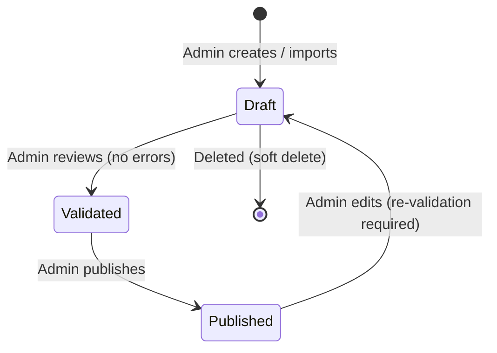
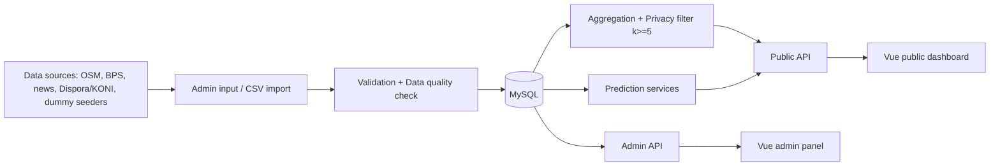
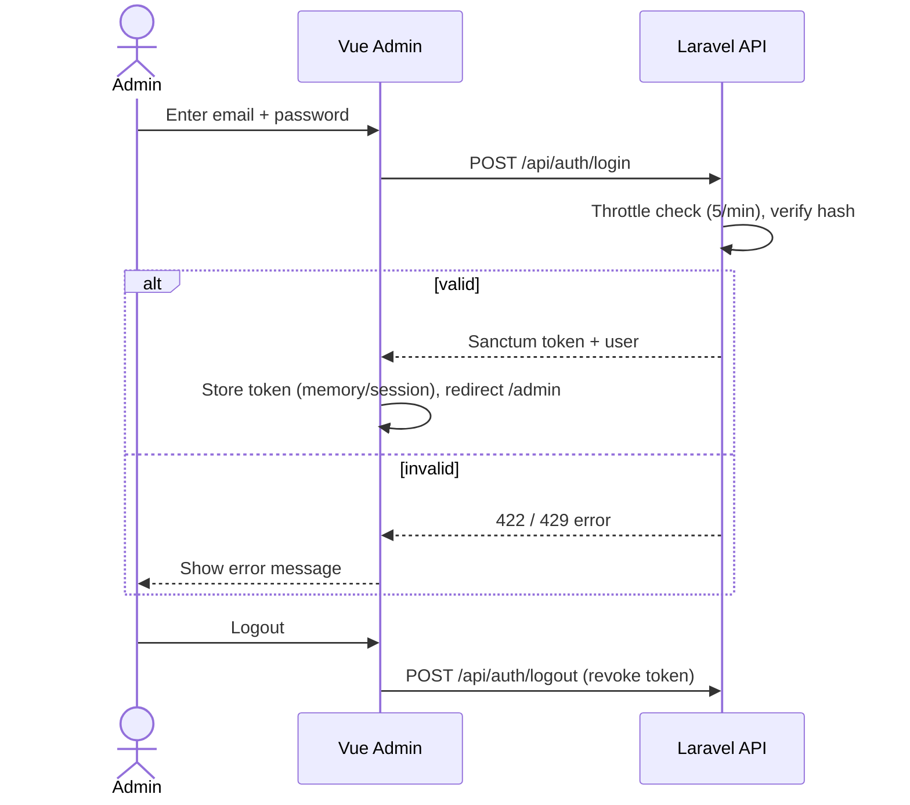
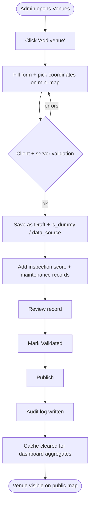
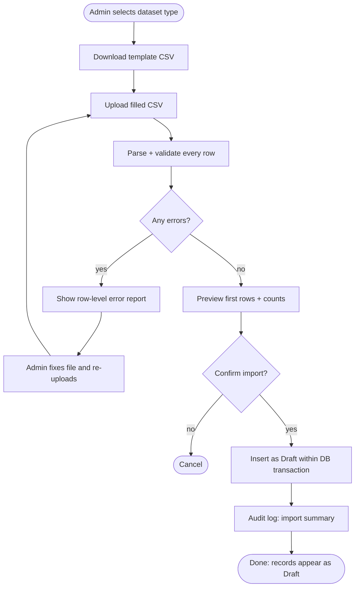
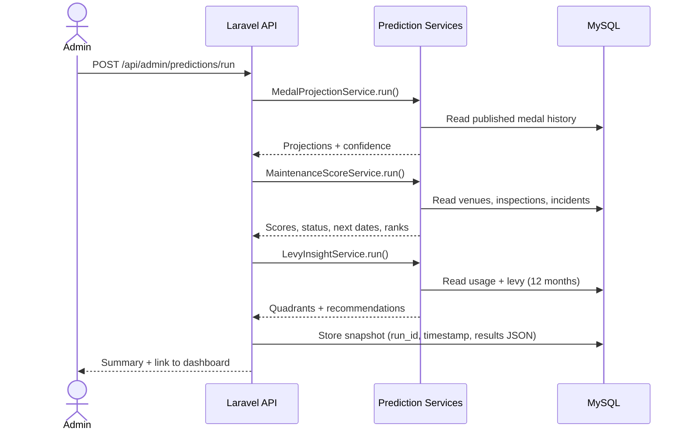
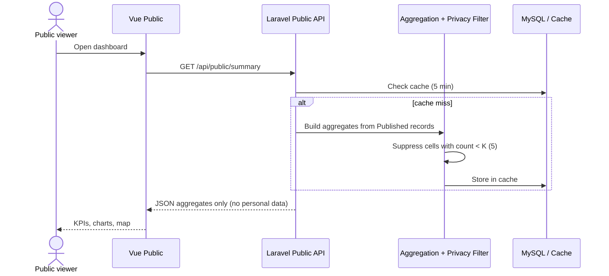
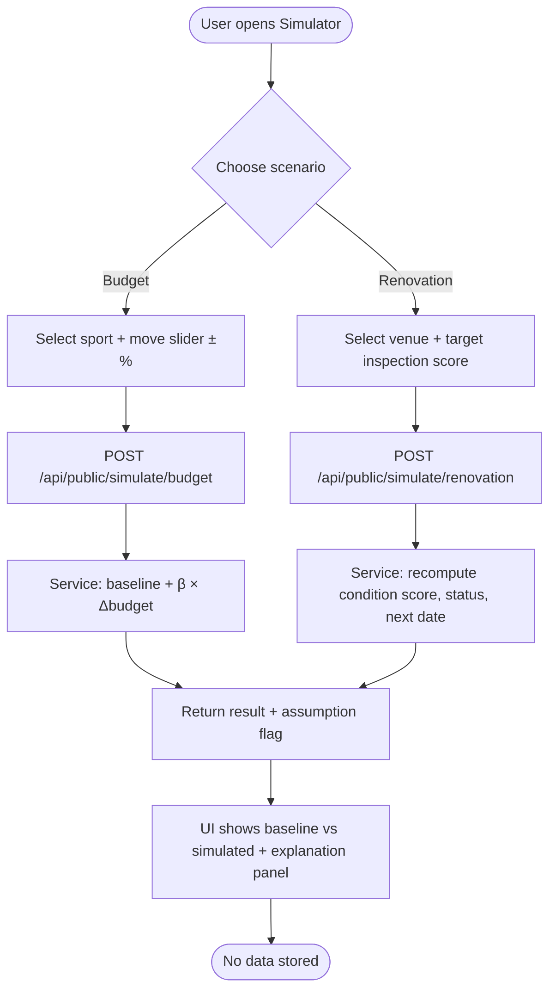
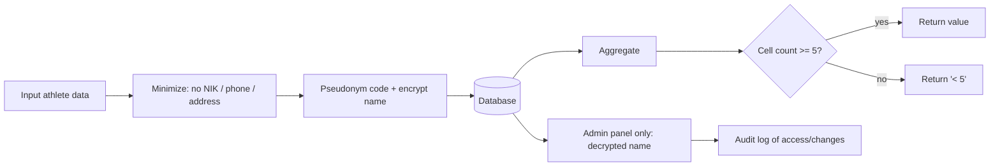

# 03 — Workflow Document

**Project:** Satu Data Dispora — Palu City
**Version:** 1.0 · Diagrams use [Mermaid](https://mermaid.js.org/) (render in GitHub, VS Code with the Mermaid extension, or mermaid.live).

---

## 1. Actors

| Actor | Description |
|---|---|
| **Admin** | Dispora data officer; logs in, inputs/validates/publishes data, runs predictions |
| **Public viewer** | Anonymous visitor; read-only access to published aggregates |
| **System** | Laravel backend (validation, aggregation, prediction, caching, audit) |

## 2. Data Lifecycle States

- Only `Published` records are used by public endpoints and predictions shown publicly.
- Every transition writes an **audit log** entry.

## 3. End-to-End System Workflow

## 4. Workflow 1 — Admin Authentication

## 5. Workflow 2 — Manual Data Entry (example: Venue + Inspection)

**Validation rules (examples)**
- Latitude between −0.95 and −0.80 and longitude between 119.80 and 119.95 (approximate Palu bounding box, configurable) — warning if outside.
- Inspection score 0–100; dates not in the future; capacity and area > 0.
- Duplicate check on (name, sub-district).

## 6. Workflow 3 — CSV Import

## 7. Workflow 4 — Prediction Run

- Public dashboard always reads the **latest snapshot**, so public users never trigger heavy computation.
- If insufficient data: service returns `confidence = low` and a reason; it never fails silently.

## 8. Workflow 5 — Public Dashboard Viewing (with Privacy Filter)

## 9. Workflow 6 — Policy Simulation

## 10. Workflow 7 — Data Protection Controls (Cross-Cutting)

## 11. Workflow 8 — Real vs Dummy Data Handling

1. Admin imports/enters records and sets `data_source` (e.g., "OSM", "Luwuk Times 2024", "Dummy seeder").
2. `is_dummy` is `true` for generated/estimated records.
3. UI shows a **Dummy** badge in admin; public pages show "n% of data is simulated" in the footer.
4. When real data replaces dummy data, admin edits the record: `is_dummy=false`, source updated, audit logged.

## 12. Error & Exception Handling

| Situation | System behaviour |
|---|---|
| Invalid form input | 422 with field-level messages |
| Unauthenticated admin request | 401 → redirect to login |
| Too many login attempts | 429 + retry-after message |
| CSV with errors | No insert; downloadable error report |
| Not enough history for prediction | Fallback method + `confidence=low` + reason text |
| Aggregation cell < 5 | Value replaced by `"<5"` |
| Server error | Generic message to the user; detailed log only in server logs |

## 13. Roles & Permission Matrix

| Action | Public | Admin |
|---|:--:|:--:|
| View published aggregates, map, predictions | ✔ | ✔ |
| Run simulations | ✔ | ✔ |
| View individual athlete records | ✘ | ✔ |
| Create / edit / delete data | ✘ | ✔ |
| Validate / publish data | ✘ | ✔ |
| Import CSV | ✘ | ✔ |
| Trigger prediction recalculation | ✘ | ✔ |
| View audit log | ✘ | ✔ |
