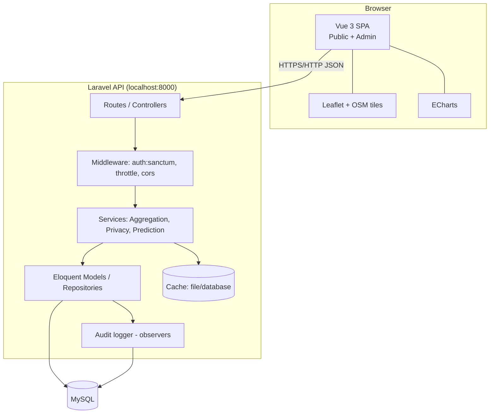
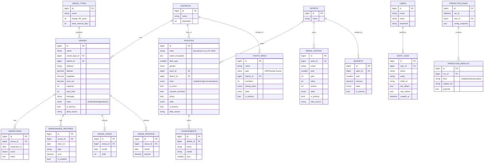
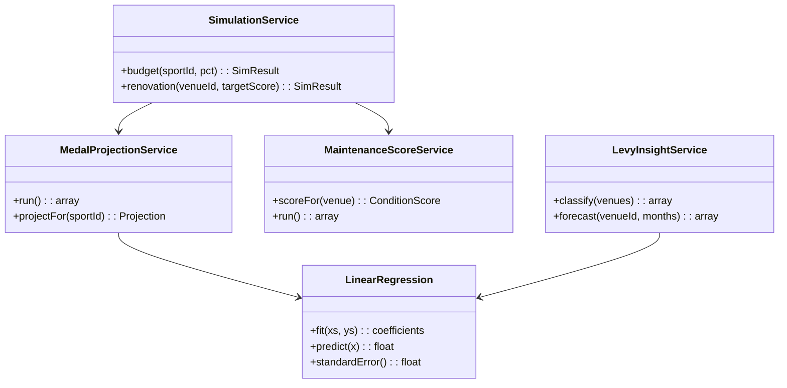

# 04 — Architecture Document

**Project:** Satu Data Dispora — Palu City
**Version:** 1.0 · **Deployment target:** Localhost

---

## 1. Architecture Overview

A classic **decoupled SPA + REST API** architecture:

- **Frontend:** Vue 3 single-page app (public dashboard + admin panel in one codebase, separated by routes and guards).
- **Backend:** Laravel REST API containing business logic, aggregation, privacy filtering, and the prediction engine (PHP service classes).
- **Database:** MySQL.
- **Map tiles:** OpenStreetMap (client-side via Leaflet).



## 2. Technology Stack

| Layer | Choice | Reason |
|---|---|---|
| Frontend framework | **Vue 3** (Composition API, `<script setup>`) + Vite | Chosen by user; fast dev |
| State | Pinia | Official, simple |
| Routing | Vue Router (with guards for `/admin`) | Role separation |
| Styling | Tailwind CSS | Rapid, consistent tokens |
| Charts | Apache ECharts (`vue-echarts`) | Rich chart types incl. scatter quadrants |
| Map | Leaflet + `leaflet.heat` + `leaflet.markercluster` | Free, no API key |
| HTTP | Axios | Interceptors for token/errors |
| Backend | **Laravel 11** (PHP 8.2+) | Chosen by user |
| Auth | Laravel Sanctum (token) | Simple admin auth |
| ORM | Eloquent | Built-in |
| DB | **MySQL 8** | Chosen by user |
| Math / stats | Native PHP service classes (OLS regression) | No extra runtime; explainable |
| Testing | PHPUnit/Pest (backend), Vitest (frontend) | Standard |
| CI | GitHub Actions | CI skill available |
| Local run | `php artisan serve`, `npm run dev` | No Docker needed |

> **Decision:** model computation stays inside Laravel (no Python service) to keep one backend language and easy local setup.

## 3. Repository Structure (Single Integrated Project)

```
satudata-dipora-palu/
├── docs/                    # 01-PRD.md ... 05-TODO.md
├── app/                     # Laravel Controllers, Models, Observers, Analytics Services
│   ├── Http/Controllers/
│   │   ├── Auth/AuthController.php
│   │   ├── Admin/       VenueController, AthleteController, MedalController, ImportController, PredictionController, AuditController ...
│   │   └── Public/      SummaryController, VenueMapController, AthleteStatsController, PredictionController, SimulationController
│   ├── Models/          Venue, Inspection, MaintenanceRecord, VenueUsage, VenueRevenue, Athlete, Achievement, MedalHistory, YouthOrg, Sport, District, Budget, PredictionRun, AuditLog
│   ├── Observers/       AuditObserver
│   └── Services/
│       ├── Analytics/   MedalProjectionService, MaintenanceScoreService, LevyInsightService, SimulationService, LinearRegression
│       └── Privacy/     AggregationService, SmallCellSuppressor
├── config/analytics.php     # weights, thresholds, K_ANONYMITY_MIN, default assumptions
├── database/migrations/     # 17 tables migration
├── database/seeders/        # DistrictSeeder, SportSeeder, RealDataSeeder, DummyDataSeeder
├── public/                  # Web entry point & compiled SPA assets (public/build)
├── resources/
│   ├── css/app.css          # Tailwind CSS styles
│   ├── js/                  # Vue 3 SPA components, views, router, stores
│   └── views/app.blade.php  # Single Blade entrypoint serving the Vue 3 SPA
├── routes/
│   ├── api.php              # 89 API routes (Public & Sanctum-protected Admin)
│   └── web.php              # Catch-all route serving app.blade.php
├── artisan                  # Laravel CLI
├── composer.json            # PHP dependencies
├── package.json             # Frontend dependencies (Vue, ECharts, Leaflet, Tailwind)
├── vite.config.js           # Laravel Vite plugin + Vue 3 compiler config
└── run.bat                  # Single 1-Click Server Runner
```

## 4. Database Design (MySQL)

### 4.1 ERD



### 4.2 Index and Constraint Notes
- Index `venues(district_id, venue_type_id, state)`, `venue_usage(venue_id, month)`, `medal_history(sport_id, year)`.
- Unique: `venue_usage(venue_id, month)`, `venue_revenue(venue_id, month)`, `athletes(code)`.
- Latitude/longitude stored as `DECIMAL(9,6)`; no PostGIS needed (point markers + heatmap only).
- Soft deletes on master tables; audit log is append-only.
- Public queries always include `WHERE state = 'published'`.

## 5. API Design

Base URL: `http://localhost:8000/api` · JSON · Sanctum bearer token for `/admin/*`.

### 5.1 Public (no auth, rate limit 60/min, aggregates only)
| Method | Endpoint | Description |
|---|---|---|
| GET | `/public/summary` | KPI cards (counts, % by status, totals, last updated, dummy %) |
| GET | `/public/venues` | Venue markers (id, name, type, district, lat, lng, status, usage_index) with filters |
| GET | `/public/venues/{id}` | Venue detail + score history + usage/levy series |
| GET | `/public/heatmap` | Array of `[lat, lng, intensity]` |
| GET | `/public/stats/athletes` | Aggregates by sport/district/age group/gender (suppressed < 5) |
| GET | `/public/stats/medals` | Medal history aggregates by event/sport |
| GET | `/public/stats/youth-orgs` | OKP/Karang Taruna aggregates |
| GET | `/public/predictions/medals` | Latest medal projections |
| GET | `/public/predictions/maintenance` | Latest ranked maintenance list |
| GET | `/public/predictions/levy` | Levy quadrants + recommendations |
| POST | `/public/simulate/budget` | `{sport_id, change_pct}` → baseline vs simulated |
| POST | `/public/simulate/renovation` | `{venue_id, target_score}` → new score/status/date |
| GET | `/public/methodology` | Model descriptions, parameters, data source list |

### 5.2 Admin (auth:sanctum)
| Method | Endpoint | Description |
|---|---|---|
| POST | `/auth/login`, `/auth/logout` | Authentication |
| GET | `/admin/me` | Current admin |
| CRUD | `/admin/venues`, `/admin/inspections`, `/admin/maintenance`, `/admin/usage`, `/admin/revenue` | Venue domain |
| CRUD | `/admin/athletes`, `/admin/achievements` | Athlete domain (decrypted name returned here only) |
| CRUD | `/admin/medals`, `/admin/budgets`, `/admin/youth-orgs`, `/admin/sports` | Other masters |
| POST | `/admin/{entity}/{id}/transition` | `{to: validated|published|draft}` |
| POST | `/admin/import/{dataset}/validate` | Upload CSV → validation report |
| POST | `/admin/import/{dataset}/commit` | Commit validated import |
| POST | `/admin/predictions/run` | Recalculate and store snapshot |
| GET | `/admin/audit-logs` | Filterable audit log |
| GET | `/admin/data-quality` | Completeness, dummy %, drafts count |

### 5.3 Response Conventions
```json
{ "data": { }, "meta": { "last_updated": "2026-11-17T08:00:00Z", "dummy_ratio": 0.62 } }
```
Errors: `{ "message": "...", "errors": { "field": ["..."] } }` with standard HTTP codes (401, 403, 404, 422, 429, 500).

## 6. Analytics Engine Design



- All formulas, weights, thresholds, and default assumptions are in `config/analytics.php` (see PRD §7).
- Services are pure (input → output) and unit-tested with fixed fixtures.
- `PredictionController@run` stores a snapshot in `prediction_runs` / `prediction_results`; public endpoints read the latest snapshot.

## 7. Security Architecture

| Concern | Control |
|---|---|
| Authentication | Sanctum tokens; bcrypt/argon hashing; login throttle 5/min |
| Authorization | `auth:sanctum` on all `/admin/*`; public routes are GET/POST-simulation only |
| Personal data | Athlete name encrypted (`encrypted` cast, `APP_KEY`); no NIK/phone/address columns; public Resources whitelist fields |
| Privacy filter | `SmallCellSuppressor` applied centrally in `AggregationService` (K from `.env`) |
| Input validation | Form Requests for every write; CSV validated row by row |
| Injection / XSS | Eloquent bindings; Vue auto-escaping; no `v-html` with user data |
| CORS | Restricted to the frontend origin (`http://localhost:5173`) |
| Audit | Observers log create/update/delete/transition/import with old/new values |
| Secrets | `.env` not committed; `.env.example` provided |
| Rate limiting | `throttle:60,1` public; `throttle:120,1` admin |

## 8. Performance & Caching
- Aggregate endpoints cached 5 minutes (`Cache::remember`), cleared on publish/transition.
- Eager loading to avoid N+1; pagination (20/page) on admin lists.
- Heatmap and markers returned as compact arrays; marker clustering on the client.

## 9. Environment & Local Setup

**Prerequisites:** PHP ≥ 8.2, Composer, Node ≥ 20, MySQL 8.

```bash
# Backend
cd backend
cp .env.example .env            # set DB_*, K_ANONYMITY_MIN=5
composer install
php artisan key:generate
php artisan migrate --seed      # districts, sports, real data, dummy data
php artisan serve               # http://localhost:8000

# Frontend
cd ../frontend
cp .env.example .env            # VITE_API_URL=http://localhost:8000/api
npm install
npm run dev                     # http://localhost:5173
```

Key `.env` values: `APP_URL`, `DB_DATABASE=satu_data_dispora`, `SANCTUM_STATEFUL_DOMAINS`, `K_ANONYMITY_MIN=5`, `CACHE_STORE=file`.

## 10. Testing Strategy

| Level | Tool | What |
|---|---|---|
| Unit | Pest/PHPUnit | OLS regression, condition score, quadrant classification, suppression |
| Feature | Pest | Auth, CRUD validation, state transitions, **public API never exposes personal fields**, K-anonymity |
| Frontend | Vitest + Vue Test Utils | StatusBadge, suppression display, simulator form |
| Manual | Checklist | Map filters, heatmap toggle, CSV import error report |

## 11. CI Pipeline (GitHub Actions)

```yaml
name: CI
on: [push, pull_request]
jobs:
  backend:
    runs-on: ubuntu-latest
    services:
      mysql:
        image: mysql:8
        env: { MYSQL_ROOT_PASSWORD: root, MYSQL_DATABASE: testing }
        ports: ['3306:3306']
        options: --health-cmd="mysqladmin ping" --health-interval=10s --health-retries=5
    defaults: { run: { working-directory: backend } }
    steps:
      - uses: actions/checkout@v4
      - uses: shivammathur/setup-php@v2
        with: { php-version: '8.2' }
      - run: composer install --no-interaction --prefer-dist
      - run: cp .env.example .env && php artisan key:generate
      - run: php artisan test
        env: { DB_CONNECTION: mysql, DB_HOST: 127.0.0.1, DB_DATABASE: testing, DB_USERNAME: root, DB_PASSWORD: root }
  frontend:
    runs-on: ubuntu-latest
    defaults: { run: { working-directory: frontend } }
    steps:
      - uses: actions/checkout@v4
      - uses: actions/setup-node@v4
        with: { node-version: 20 }
      - run: npm ci
      - run: npm run lint --if-present
      - run: npm run test --if-present
      - run: npm run build
```

## 12. Architecture Decision Records (Summary)

| # | Decision | Alternatives | Rationale |
|---|---|---|---|
| ADR-1 | Predictions in Laravel (PHP) | Python microservice | Single language, easier localhost run, models are simple OLS/rules |
| ADR-2 | MySQL with lat/lng decimals | PostGIS | Only points + heatmap required |
| ADR-3 | Aggregates-only public API | Public athlete list | Compliance with UU PDP, lower risk |
| ADR-4 | Snapshot-based predictions | Compute on every request | Stable numbers, fast public pages, audit of runs |
| ADR-5 | Rule-based maintenance score | ML classifier | Little data, need explainability |
| ADR-6 | Leaflet + OSM | Google Maps | No API key / cost |
| ADR-7 | Hybrid real + dummy data with flags | Fully dummy | Honest about data availability |
| ADR-8 | Single admin role | RBAC | Requirement: admin only |

## 13. Known Limitations
- Forecast quality depends on limited historical points; confidence labels communicate this.
- Dummy data cannot validate real-world accuracy of models.
- No integration with external government systems in v1.
- Localhost only: no production hardening (HTTPS, backups, monitoring) beyond configuration readiness.
